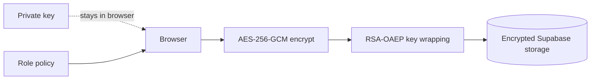

# Cyrpto Cloud

> Private cloud storage where files are encrypted before they leave your browser.

 

Cyrpto Cloud is a storage prototype built around browser-side WebCrypto, Supabase, and explicit role-based access control.

## Highlights

- AES-256-GCM encryption for file contents
- RSA-OAEP wrapping for per-file keys
- Supabase Auth, Postgres, and Storage integration
- RBAC roles: `admin`, `user`, and `viewer`
- Upload, download, and delete controls based on role

## Security flow



## Quick start

```bash
git clone https://github.com/boss477/cyrpto_cloud.git
cd cyrpto_cloud
npm install
```

Create `.env.local` with `NEXT_PUBLIC_SUPABASE_URL` and `NEXT_PUBLIC_SUPABASE_ANON_KEY`, run [`db/schema.sql`](db/schema.sql), create the `secure-files` bucket, then run `npm run dev`.

## Project map

`encryption/` contains WebCrypto primitives · `auth/` handles identity · `rbac/` owns permissions · `storage/` coordinates encrypted objects · `pages/` and `components/` contain the UI.

## Important limitations

This is a security-focused prototype, not a completed security product. Review key persistence, bucket policies, recovery, threat modeling, and deployment configuration before handling sensitive data.
